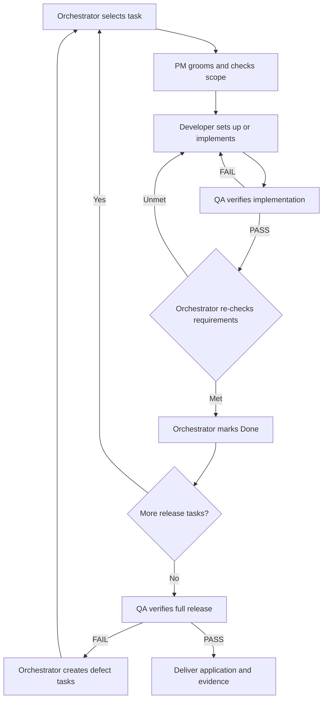

# Build an application with AI using specifications

Use this template to turn an application idea into working, verified code with an AI coding assistant. You describe the product and review decisions; the assistant maintains the specifications, creates tasks, writes code, and runs checks.

The template works with any programming language, platform, or AI assistant. It starts with Markdown documents. Application code is created in step 5, after you agree on what to build and how to build it.

## What you need

- An application idea and someone who can decide its scope (usually you).
- A copy of this repository and an AI coding assistant that can read and edit it and run commands.
- Permission for the coding assistant to install and configure the tools required by the chosen stack during setup tasks.

If you use a chat assistant without repository access, supply the relevant documents and apply its proposed file changes and commands yourself.

## 1. Create your project

Use this repository as a template, or copy it into a new project directory. Open that directory in your editor and start your coding assistant there.

Tell the assistant:

> Read `AGENTS.md`. We will use this repository to build an application. Follow its spec-driven workflow and ask questions when important details are uncertain.

Keep the workflow documents in your new project; they provide context when you start a fresh AI session. You can use one assistant throughout. Separate agents and automation are optional.

## 2. Describe the application you want

Replace `[your application idea]` in this prompt and send it to the assistant:

> Help me turn [your application idea] into a product specification in `_docs/plan.md`. Ask one focused question at a time about users, main workflows, expected outcomes, first-release scope, failure cases, data, and constraints. Record my answers. Keep technology choices separate. After scope confirmation, check the Git remote named `origin`. Only if it points to GitHub, create or update one GitHub issue per concrete task identified in `_docs/plan.md`, link each issue to its requirement IDs, and keep issues and local task documents synchronized using `_docs/process.md`. Do not create issues for unresolved questions or template placeholders. Do not write application code yet.

Answer the questions, then read the completed plan. Correct anything that does not describe the application you want. Pay particular attention to what the first version includes and excludes.

**Before continuing:** confirm the first-release scope and resolve questions that would change its behavior. The result is your product specification in [_docs/plan.md](_docs/plan.md).

## 3. Choose the stack

Ask:

> Read the product specification. Compare suitable implementation approaches, explain their tradeoffs, and recommend one. Include the development tools I will need. Do not scaffold the application until I choose an approach.

Choose an approach you can run, maintain, and review. If you have a preferred language, platform, or framework, tell the assistant now. Then ask:

> Record the selected approach in `_docs/architecture.md` and significant decisions in `_docs/decisions/`. Document prerequisites and intended setup, run, and verification commands in `_docs/commands.md`. Identify the installation and configuration work for the developer to perform as setup tasks. Leave commands explicitly unverified until those tasks validate them.

The developer agent will install tools, configure the local environment, and validate it through the initial tasks. You review the architecture; no manual setup is required as a workflow step. If installation needs elevated permissions, account access, or credentials, the agent requests only that specific input or authorization and continues once it is available.

**Before continuing:** the architecture is agreed and the setup work is identified for the developer. There is still no requirement to have application code at this stage.

## 4. Hand delivery over to the orchestrator

Once the product specification and architecture are agreed, send one delivery prompt:

> /goal Read `AGENTS.md` and act as the orchestrator in `_docs/team/orchestrator.md`. Deliver the agreed first release from `_docs/plan.md` and `_docs/architecture.md`. Delegate backlog creation and grooming to PM, setup and implementation to the developer, and verification to QA. Refine the task labeled `environment-setup` and the dependent application skeleton task, then create the feature tasks. Coordinate the graph in `_docs/process.md` through final release verification. Handle routine decisions, handoffs, fixes, and task completion without asking me to advance each step. Use the default execution limits. Ask me only for consequential unresolved decisions, scope changes, required access, or authorization. Record progress in `_docs/tasks.md` so another session can resume.

`/goal` gives a supporting assistant a persistent objective; the orchestrator instructions define how work moves through the roles. Completion requires all agreed release tasks to be Done and final QA to pass against the delivered code. Execution limits and blockers still apply; a goal does not grant extra permissions or guarantee uninterrupted execution.

Supported environments include [Codex builds with Goals](https://developers.openai.com/cookbook/examples/codex/using_goals_in_codex) (0.128.0 or later), [Claude Code](https://claude.com/resources/articles/getting-started-with-loops), and [Cursor versions with Goals enabled](https://cursor.com/docs/agent/overview#goals-with-goal). Availability depends on your installed version and interface. Check its slash-command menu before starting.

**Fallback:** if `/goal` is unavailable, remove only `/goal` and send the same prompt. The assistant can follow the graph, but automatic continuation between turns depends on its environment. If it stops early, use the resume prompt in step 6. A custom command named `/goal` is not necessarily a persistent execution loop.

The orchestrator now owns task selection, role dispatch, readiness checks, retries, and backlog updates. PM reviews each task against the scope you already agreed; you do not need to approve every task separately.

Use a coding environment with subagent support for separate PM, developer, and QA agents. If subagents are unavailable, the orchestrator performs distinct sequential role passes and records the reduced QA independence. These Markdown files define the graph; your coding environment executes it.

## 5. Let the agents set up and build the application

The orchestrator routes work through this graph:

The developer first installs and configures the environment through the task labeled `environment-setup`. After QA passes it and the orchestrator re-checks its requirements and marks it Done, the developer creates and starts the application skeleton and runs its smoke check. Feature tasks follow the same grooming, implementation, and verification cycle.

The developer executes setup and checks and records validated commands in [_docs/commands.md](_docs/commands.md). You do not need to install tools, route tasks, run routine tests, or request each retry. After QA PASS, the orchestrator re-checks the implementation against the task’s linked requirements and acceptance criteria and records evidence before marking Done. QA failures or unmet requirements return the task to In progress and the developer, followed by fresh QA and another orchestrator re-check. Unverifiable requirements block completion. The cycle continues automatically within the agreed scope and execution limits.

During delivery, PM commits specification, task, and backlog changes after each grooming pass and records the grooming commit in the handoff. New-task grooming is committed on `develop`; grooming for fixes uses the existing task branch. The developer creates each `task/<task-id>-<short-title>` branch from `develop` and commits implementation and fixes there. QA and the orchestrator verify the recorded implementation commit. After the requirements re-check passes, the orchestrator marks Done, merges the task branch into `develop`, and checks integration before continuing. Integration failures return to the developer. Pushes run automatically only for remotes and branch targets you have authorized; otherwise delivery stays in local commits. Force pushes and history rewriting require explicit authorization. See the [Git policy](_docs/process.md#branching-commits-merges-and-pushes).

## 6. Respond only when your input is needed

The orchestrator asks about consequential uncertainty, changes to agreed scope or architecture, unavailable credentials or permissions, and required authorization. It records the answer and continues. Routine reversible implementation decisions are handled within the agreed constraints.

Blocked work stays incomplete. The orchestrator routes technical blockers to the developer and product ambiguity to PM, continuing independent eligible work when possible. It never treats unavailable checks as passing.

Default limits are three developer-to-QA attempts per task and ten completed tasks per delivery batch. You can override these in the kickoff prompt. At a limit or when no work can proceed, the orchestrator reports the reason and records task states, retry counts, evidence, and the next action in `_docs/tasks.md`.

To resume in the same or a fresh session:

> Read `AGENTS.md`, `_docs/tasks.md`, and the linked task handoffs. Resume as orchestrator from the recorded state, preserving agreed scope and decisions. Start a new delivery batch with the default limits. Preserve per-task retry counts; ask for a specific limit extension if a task has exhausted its attempts. Continue the graph until verified completion or a documented stop condition.

## 7. Receive the working application

After the release tasks are Done, the orchestrator sends the integrated application to QA for full user-journey verification and required regression checks. Failures become defect tasks and reenter the graph within the execution limits.

The final delivery includes completed scope, the verified code revision or working-tree state, verification evidence, known limitations, and exact startup instructions from [_docs/commands.md](_docs/commands.md). You can then try the application yourself.

**Working application code means:** all agreed first-release tasks are Done, the application starts using documented commands, and final QA passes for the specified user journeys and required checks. Distribution or deployment must be explicit tasks if needed and still require applicable authorization.

Describe future changes to the orchestrator. It assesses the impact, resolves consequential decisions with you, updates specifications and tasks, and follows the same graph.

## Where the project information lives

| Document | What you use it for |
| --- | --- |
| [AGENTS.md](AGENTS.md) | Give a new AI session the project rules and document map |
| [_docs/plan.md](_docs/plan.md) | Define what the application must do |
| [_docs/architecture.md](_docs/architecture.md) | Record how it will be built |
| [_docs/commands.md](_docs/commands.md) | Find exact setup, run, and verification instructions |
| [_docs/tasks.md](_docs/tasks.md) | Find the next task and track progress |
| [_docs/task-template.md](_docs/task-template.md) | Specify each task before implementation |
| [_docs/process.md](_docs/process.md) | Check readiness, completion, and change rules |
| [_docs/testing-guidelines.md](_docs/testing-guidelines.md) | Define how to verify behavior |
| [_docs/prompts.md](_docs/prompts.md) | Find additional reusable prompts |
| [_docs/team/](_docs/team/) | Give the assistant PM, engineer, QA, or coordinator responsibilities |
| [_docs/templates/](_docs/templates/) | Create decision and verification records |

Replace angle-bracket placeholders in prompts and documents with project facts. Resolve blocking placeholders before marking a task Ready; a task may explicitly deliver configuration that does not exist yet.

When `origin` points to GitHub, GitHub issues are the authoritative task backlog; local task files and `_docs/tasks.md` are synchronized specifications and an index/checkpoint. Otherwise, use only the local Markdown backlog. See the [issue synchronization policy](_docs/process.md#github-issue-synchronization).

`CLAUDE.md` points to `AGENTS.md`. For other assistants, explicitly ask them to read `AGENTS.md` if they do not discover it automatically. The role files and prompts describe a workflow; they do not launch agents or automate it. The delivery graph and execution limits from step 4 onward are described in `_docs/process.md`.

## Inspiration

Based on Alexey Grigorev’s [AI-Native Development: Specifications, Loop and Graph Engineering](https://aishippingblog.com/p/ai-native-development-specifications), adapted into a local-first, language- and platform-agnostic template with requirement links and verification records.

## License

This template is licensed under the [MIT License](LICENSE).
