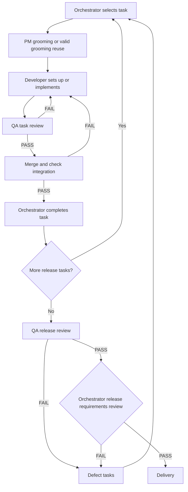

# Development process

## Sources of truth

The [product plan](plan.md) defines intended behavior; [architecture](architecture.md) and decision records define agreed constraints. Tasks describe scoped changes and link to these sources. [tasks.md](tasks.md) identifies the authoritative backlog. Resolve conflicts before dependent work; an implementation is not evidence that a requirement changed.

This document owns shared lifecycle, delivery gates, limits, and Git/backlog policies. Role procedures belong in the dedicated [PM](team/pm.md), [developer](team/software-engineer.md), [QA](team/qa-engineer.md), and [orchestrator](team/orchestrator.md) guides. Follow [testing guidelines](testing-guidelines.md) for verification and [execution policy](team/execution-policy.md) for shared runtime guidance.

## Lifecycle and gates

`Draft → Ready → In progress → In review → Done`

| State | Entry condition |
| --- | --- |
| Draft | Task is being defined using the [task template](task-template.md). |
| Ready | Goal, acceptance criteria, exclusions, constraints, and verification plan are complete; task dependencies are Done; blocking questions are resolved; PM scope review against the agreed specification is recorded. A task may deliver command configuration that does not exist yet. |
| In progress | One Ready task is selected for implementation, or a reviewed task returns for fixes. Implement one task at a time. |
| In review | Implementation and its handoff are ready for QA at an exact recorded state. |
| Done | QA PASS covers the implementation state, integration and other required checks pass, documents match agreed behavior, material findings are resolved, and completion records are checked. |

Use `Blocked` when work cannot proceed; record the reason, required input, and prior state. After resolution, return to the appropriate prior state. QA or integration failures return the task to `In progress`; changed requirements return it to `Draft`.

## Delivery graph

Discovery and architecture selection follow [README steps 1–3](../README.md#2-describe-the-application-you-want). After the user hands over delivery in README step 4, follow this graph using the linked role guides:

BLOCKED outcomes use the lifecycle rule above and [orchestrator routing](team/orchestrator.md#routing-and-completion). Final delivery requires all agreed release tasks Done, QA release PASS, and a passing orchestrator release requirements review at the delivered revision. See the respective [QA release procedure](team/qa-engineer.md#release-review) and [orchestrator release procedure](team/orchestrator.md#release-review-and-delivery).

## Changes and defects

When scope changes, update the specification first, assess affected tasks and prior verification, and record significant decisions. Preserve requirement identifiers. Defects within agreed scope need reproducible findings; new behavior becomes a separate task. Apply the [evidence reuse rules](testing-guidelines.md#reusing-evidence) to changed implementations.

## Autonomy and limits

During handed-over delivery, routine reversible choices, grooming, handoffs, fixes, local delivery commits, and state updates need no per-task user approval. Escalate consequential uncertainty, changes outside agreed scope or architecture, missing access/credentials, required authorization, or exhausted limits. Honor user cost/time limits and tool restrictions. A goal command does not grant additional permissions or guarantee continuation.

Default limits are three developer-to-QA attempts per task and ten task completions per delivery batch unless overridden. Each implementation handoff submitted to QA consumes an attempt. Session changes and batch renewal do not reset task retry counts; exceeding them requires an explicit extension. Stop at verified completion, an execution limit, or no eligible work. Checkpoint and resume procedures belong to the [orchestrator](team/orchestrator.md#checkpoints-and-resumption).

## Branching, commits, merges, and pushes

This policy applies to application delivery after README step 4. For maintenance and other work, follow [AGENTS.md](../AGENTS.md).

Use `develop` as the delivery branch. Follow the role guides for [grooming commits](team/pm.md#grooming-and-handoff), [implementation branches and commits](team/software-engineer.md#implementation-and-handoff), and [integration](team/orchestrator.md#routing-and-completion).

Handoffs identify the branch and full commit hash. Keep the implementation commit immutable during QA. Evidence/status-only commits may follow, with the verified implementation commit and final branch tip recorded separately. Do not create commits solely to insert their own hashes; record the delivery hash in the next normal checkpoint. Implementation changes require a new commit and affected verification under the testing guidelines.

Push only to user-authorized remotes and branch targets; delivery handover alone does not authorize pushes. Preserve authorization across sessions. Without it, retain local commits and report pending pushes. A push failure does not invalidate local verification. Force pushes, published-history rewriting, remote branch deletion, and destructive Git operations require explicit authorization. Preserve task branches by default; never bypass protections or required checks.

## GitHub issue synchronization

After product scope confirmation, select backlog mode from the Git remote named `origin`. Enable GitHub mode only for a confidently identified GitHub repository, including an SSH alias resolving to GitHub. Otherwise use the local backlog. Record the mode/repository in [tasks.md](tasks.md) and re-check before external writes if the remote changes.

In GitHub mode, the user's delivery instruction authorizes task issue creation and updates in that origin repository. It does not authorize pushes or unrelated external actions. Use authenticated tooling; unavailable access leaves synchronization pending and requires only the missing access.

- GitHub issues own task scope and status; local task files mirror them and `tasks.md` is the index/checkpoint. In local mode, the linked Markdown backlog remains authoritative.
- Use the [task template](task-template.md) for issue content and local task files. Preserve IDs and labels, record the issue URL in the task/index, and link the local task path from the issue.
- Read issue changes before grooming, implementation, and each handoff. Resolve conflicts with specifications or concurrent local edits before dependent work; never silently overwrite either version or accept unapproved scope changes.
- At handoffs, the acting role updates content, criteria, dependencies, findings, evidence, and explicit lifecycle status in both places. Keep issues open until completion and integration succeed; then close with verification and delivery commit links. Reopen if work returns to In progress.
- On synchronization failure, preserve local changes and record the issue, pending updates, error, and next action in `tasks.md`. Reconcile before dependent work; unrelated eligible work may continue. Never create replacement issues merely because an update failed.

Issue creation belongs to [PM](team/pm.md#backlog-preparation); delivery reconciliation belongs to the [orchestrator](team/orchestrator.md#routing-and-completion).
